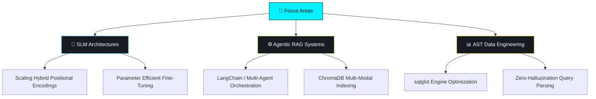

<div align="center">

<!-- Futuristic Typing Header -->
<a href="https://github.com/Harshit26042004">
  
</a>


[](https://www.linkedin.com/in/harshit-subramanian)
[](https://huggingface.co/harshit36)
[](https://www.kaggle.com/harshit264)
[](https://www.hackerrank.com/profile/21CS058_KPRIET)
[](https://stackoverflow.com/users/harshit-s)

<br>


</div>

---

<div align="center">

### 🧭 Quick Navigation

[📊 Stats](#-github-stats) · [👋 About](#-about-me) · [🛠️ Tech Stack](#️-tech-stack) · [🚀 Projects](#-featured-projects) · [🔬 Research](#-deep-dive-research--publications) · [🗺️ Roadmap](#️-roadmap)

</div>

---

<div align="center">

</div>

## 📊 GitHub Stats

<div align="center">


<br>


</div>

---

<div align="center">

</div>


## 👋 About Me

```typescript
const harshit: Developer = {
  name:     "Harshit Subramanian",
  role:     "Software Development Engineer (SDE-III) // AI & ML Specialist",
  location: "📍 Coimbatore, India",
  
  focus: [
    "🧠 Architecting Custom Small Language Models (SLMs) & Hybrid Encodings",
    "📚 Building zero-hallucination Retrieval-Augmented Generation (RAG) Systems",
    "⚙️ High-precision AST parsing for data engineering workflows",
    "⚡ High-performance algorithmic optimization & system design",
  ],

  stack: {
    languages: ["Python", "Java", "SQL", "Bash"],
    backend:   ["Streamlit", "Pandas", "Seaborn"],
    ai_ml:     ["PyTorch", "Hugging Face", "LangChain", "ChromaDB", "PEFT"],
    devOps:    ["Docker", "Git", "Linux"],
  },

  leisure:   ["🏋️ Fitness & Body Recomposition", "🎮 Gaming", "🎵 Audio Immersion", "⚡ Competitive Programming"],
  principle: "Optimized · Deterministic · Architected for Scale",
};
```

---

<div align="center">

</div>

## 🛠️ Tech Stack

<div align="center">
<a href="[https://skillicons.dev](https://skillicons.dev)">
  
</a>
<br>

**Languages & Frameworks**


**AI / ML & Tooling**


</div>

---

<div align="center">

</div>

## 🚀 Featured Projects

| Project | Description | Tech | Source |
|---|---|---|---|
| 🧠 **NOVA-Verse SLM** | Custom 14M parameter Small Language Model utilizing a proprietary hybrid positional encoding mechanism. Fine-tuned on Project Gutenberg. |   | [Model](https://huggingface.co/harshit36/NOVA-Verse) |
| 📚 **DocMentor RAG** | Enterprise-grade Retrieval-Augmented Generation tutor system. Features custom document mentoring with real-time vector embeddings. |   | [Repo](https://github.com/Harshit26042004) |
| ⚙️ **SQL Table Extractor** | Robust parsing utility leveraging `sqlglot`. Capable of high-precision AST processing to isolate base tables/columns while ignoring aliases and CTEs. |   | [Repo](https://github.com/Harshit26042004) |
| 📊 **Expense Analytics** | Full-stack financial visualization engine processing JSON entries into dynamic time-series filters, stacked bars, and donut charts. |   | [Repo](https://github.com/Harshit26042004) |
| 🌴 **TripWise** | Travel organization app featuring smart routing, budget estimation, and a custom T-shaped palm tree brand aesthetic. |   | [Repo](https://github.com/Harshit26042004) |
| ⚡ **Optimization Suite** | Production-grade repository of advanced DSA implementations focused on runtime optimization, graph traversals, and dynamic programming. |   | [Repo](https://github.com/Harshit26042004) |

---

<div align="center">

</div>

## 🔬 Deep-Dive Research & Publications

> My core research focuses on pushing the boundaries of parameter efficiency, custom tokenization, and contextual retention in Language Models.

<table>
<tr>
<td width="50%" valign="top">

<b>📄 NOVA & NOVA-Verse: Designing a 14M Parameter Language Model with Custom Hybrid Positional Encodings</b>

<p><i>Open Research & Model Architecture Documentation · Sep 2025</i></p>

Engineered a proprietary hybrid positional encoding mechanism for optimized context retention, proving efficiency at a micro-scale.

<br>

<a href="[https://huggingface.co/harshit36/NOVA-Verse](https://huggingface.co/harshit36/NOVA-Verse)">
  
</a>


</td>
<td width="50%" valign="top">

<b>📄 Architectural Innovations in Small Language Models (SLMs): Parameter-Efficient Training</b>

<p><i>Technical Report & Open Source Implementation · Oct 2025</i></p>

Deep-dive lab exploring custom tokenization on the Project Gutenberg corpus and the application of Parameter-Efficient Fine-Tuning (PEFT).

<br>

<a href="[https://github.com/Harshit26042004](https://github.com/Harshit26042004)">
  
</a>


</td>
</tr>
</table>

---

<div align="center">

</div>

## 🗺️ Roadmap



---

<div align="center">


<br>

### 🌟 *"Deterministic architecture for non-deterministic AI."*

<br>

### 🤝 Let's Build Something Together

[](https://www.linkedin.com/in/harshit-subramanian)
[](https://huggingface.co/harshit36)
[](https://github.com/Harshit26042004)

<br>


**⭐️ From [Harshit26042004](https://github.com/Harshit26042004) — Made with 💜 in Markdown**


</div>
